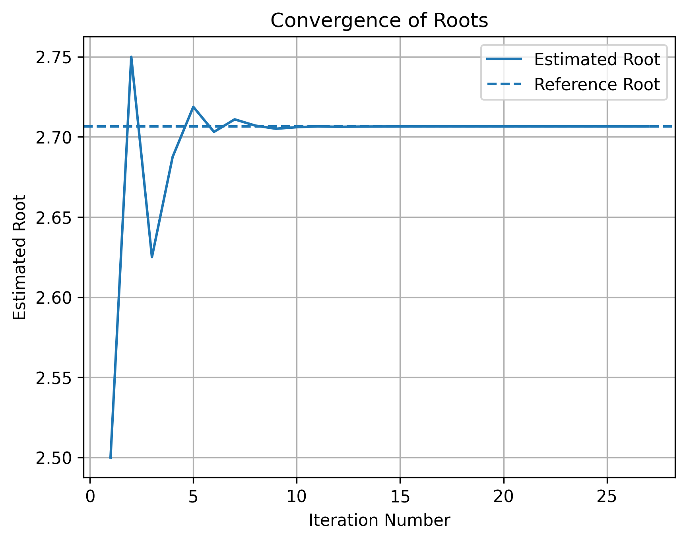
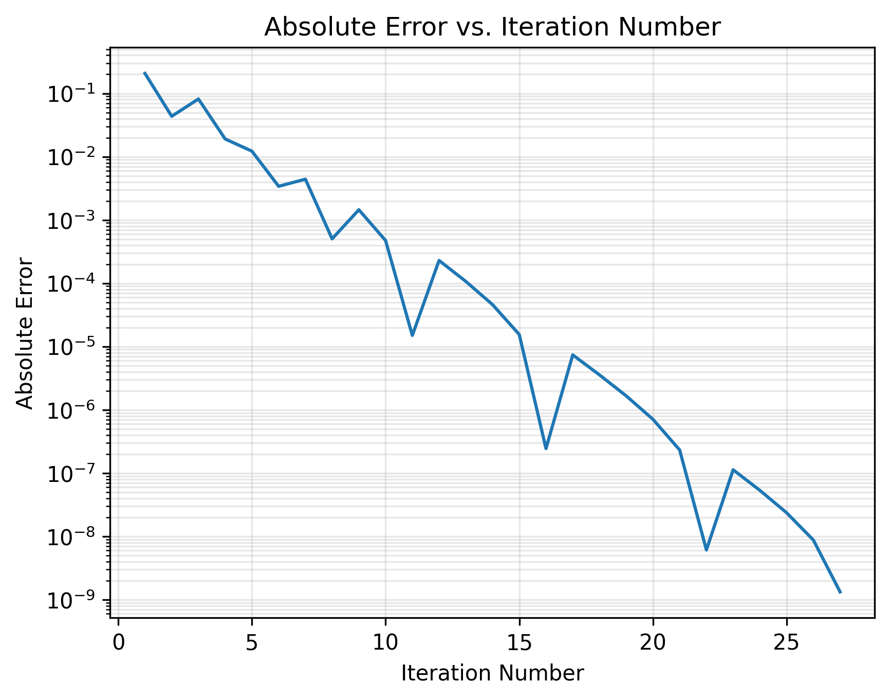

# Day 2 - Bisection Method

## Objective
Develop a Python program to approximate the root of a nonlinear equation using the bisection method.

## Method

The bisection method is a numerical root-finding technique that repeatedly divides an interval in half to locate a root of a continuous function.

For an initial interval [a,b], the midpoint is calculated using:

[
c = \frac{a+b}{2}
]

The function is evaluated at the midpoint, and the interval is updated based on where the sign change occurs.

- If [f(a)f(c)<0], the root is bracketed between $a$ and $c$.
- If [f(a)f(c)>0], the root is bracketed between $c$ and $b$.
- If [f(c)=0], an exact root has been found.

This process repeats until the desired convergence tolerance is satisfied.

## Implementation

The program implements a reusable bisection function that accepts a mathematical function, initial interval boundaries, convergence tolerance, and maximum iteration count.

The algorithm also includes input validation to reject invalid intervals and reports when convergence cannot be achieved within the specified iteration limit.

The method was tested using:

[
f(x)=x^3-4x-9
]

With the following parameters:

- Initial interval: [2,3]
- Tolerance: [10^{-8}]
- Maximum iterations: 100

## Results

The algorithm converged to an approximate root of:

[
x \approx 2.706528
]

The following plots demonstrate how the root estimate approaches the solution and how the absolute error changes with iteration number.

### Root Convergence

### Absolute Error Convergence

The estimated root approaches the solution as the interval containing the root becomes progressively smaller.

Although the absolute error may occasionally increase between iterations, the bisection method guarantees that the bracketing interval shrinks by half each iteration.

## Takeaway

The bisection method provides a reliable approach for approximating roots of continuous functions when the initial interval brackets a root.

The algorithm demonstrates the importance of convergence criteria, iteration limits, input validation, and error analysis when developing numerical software.