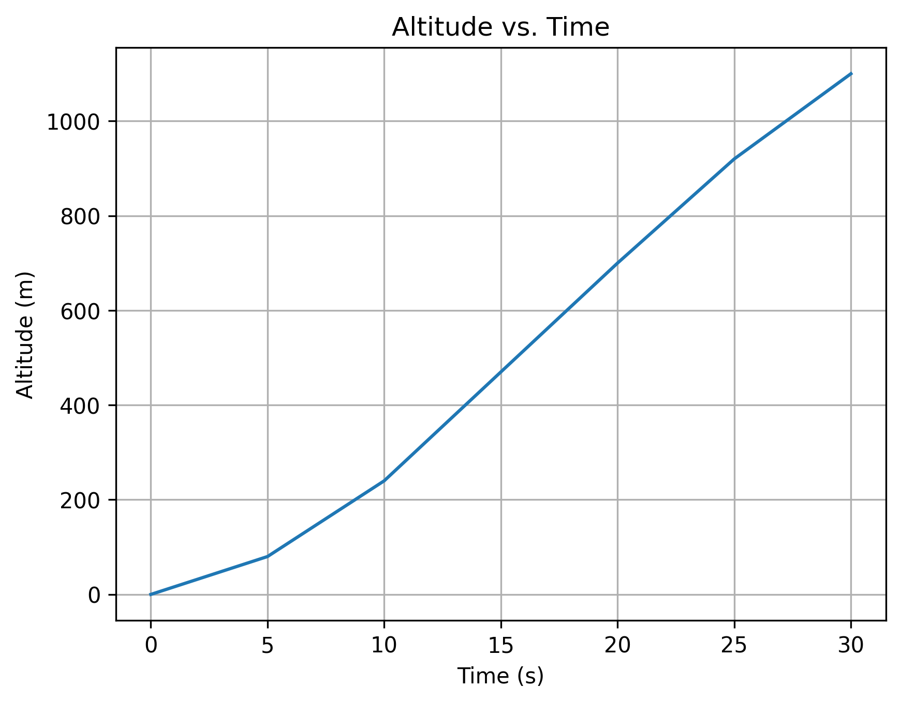
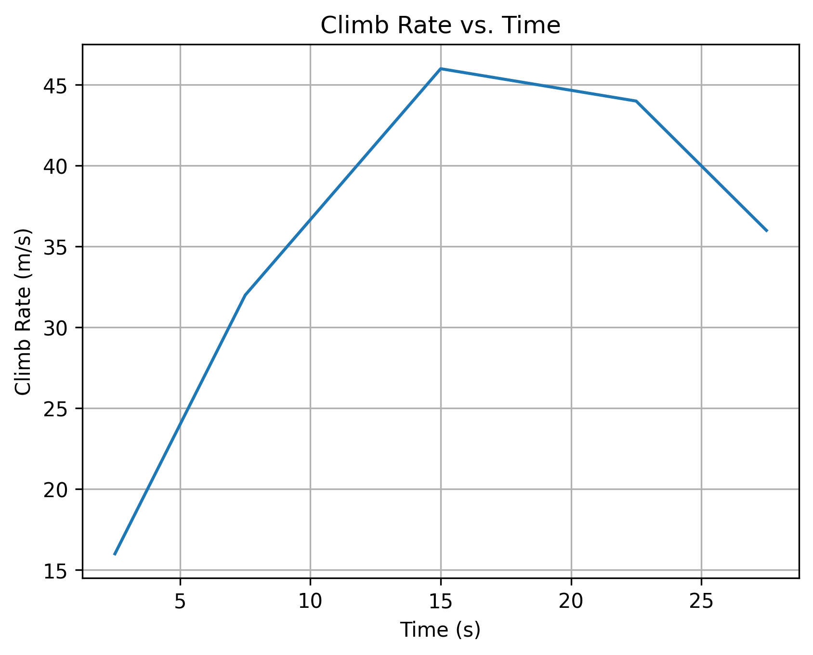

# Day 3 - Flight Data Analyzer

## Objective

Develop a Python program to read and analyze aircraft flight data from an external text file, calculate performance metrics, and visualize the results.

## Method

The program reads flight measurements containing time, altitude, and velocity, then organizes the measurements into a list of dictionaries.

The flight data is analyzed to determine:

- Maximum altitude
- Maximum velocity
- Average climb rate
- Climb rates between consecutive measurements
- Maximum climb rate and its corresponding time interval

The average climb rate over the entire flight is calculated using:

$$
V_{\text{climb,avg}} = \frac{h_f-h_i}{t_f-t_i}
$$

The climb rate between consecutive measurements is calculated using:

$$
V_{\text{climb},i} = \frac{h_{i+1}-h_i}{t_{i+1}-t_i}
$$

## Implementation

The program is organized into three functions:

**1. `load_flight_data()`**

Reads flight measurements from `flightdata.txt`, converts the values into floating-point numbers, and stores them in a list of dictionaries.

**2. `analyze_flight()`**

Processes the flight measurements and calculates the performance metrics. The function returns a dictionary containing the results.

**3. `plot_flight()`**

Generates and saves plots of altitude and climb rate versus time.

The program also checks that the dataset contains at least two measurements and that timestamps are strictly increasing.

## Results

The simulated flight dataset produced the following results:

| Parameter | Result |
|---|---|
| Maximum Altitude | 1,100 m |
| Maximum Velocity | 115 m/s |
| Average Climb Rate | 36.67 m/s |
| Maximum Climb Rate | 50 m/s |
| Maximum Climb Interval | 15–20 s |

### Altitude vs. Time

### Climb Rate vs. Time

The altitude profile shows the aircraft gaining altitude throughout the simulated flight.

The climb-rate analysis indicates that the maximum average climb rate occurred between 15 and 20 seconds.

## Takeaway

This project demonstrated how Python can be used to process structured engineering data, calculate performance metrics, and visualize results.

Separating file loading, data analysis, and visualization into independent functions improved the program's organization, reusability, and maintainability.