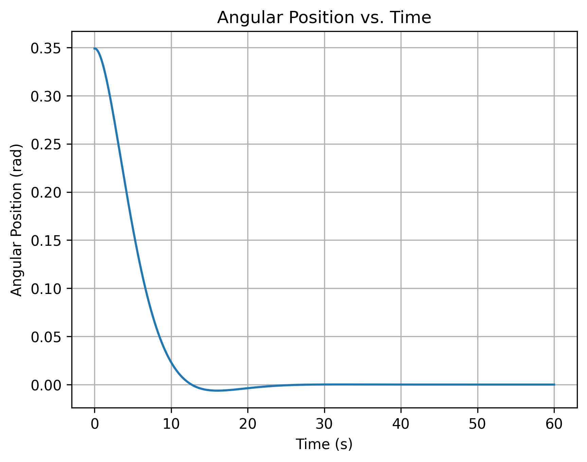
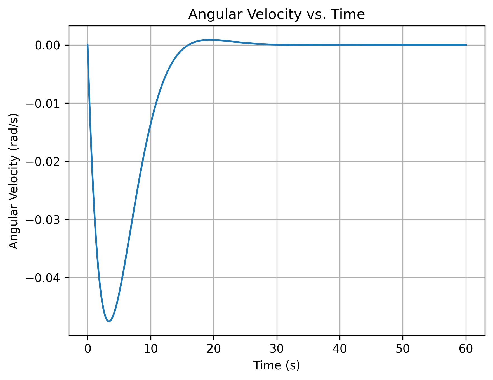
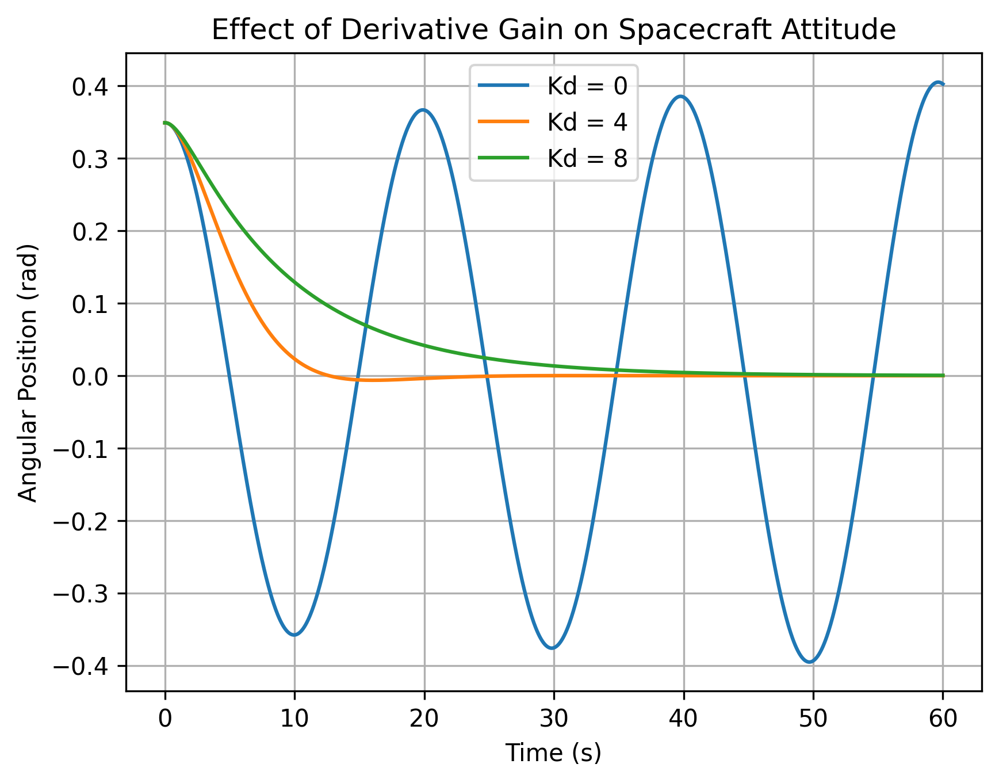

# Day 6 - Spacecraft Attitude Control Simulator

## Objective

Develop a Python program to simulate the rotational motion of a spacecraft using a proportional-derivative (PD) controller and numerical integration.

The objective is to investigate how feedback control influences spacecraft orientation, angular velocity, and system stability.

## Method

The spacecraft is modeled as a rigid body rotating about a single principal axis.

The rotational equation of motion is:

$$
I\ddot{\theta} = \tau
$$

Where:
- $I$ = Spacecraft moment of inertia
- $\theta$ = Angular position
- $\tau$ = Applied control torque

A proportional-derivative controller calculates the required control torque using:

$$
\tau = -K_p(\theta-\theta_{\text{target}})-K_d\dot{\theta}
$$

Where:
- $K_p$ = Proportional gain
- $K_d$ = Derivative gain
- $\theta_{\text{target}}$ = Desired spacecraft orientation

The spacecraft's angular position and angular velocity are propagated using the forward Euler integration method:

$$
\theta_{i+1} = \theta_i+\omega_i\Delta t
$$

$$
\omega_{i+1} = \omega_i+\frac{\tau_i}{I}\Delta t
$$

## Implementation

The program is organized into four functions:

**1. `deg_to_rad()`**

Converts angular measurements from degrees to radians to maintain consistent units throughout the simulation.

**2. `control_torque()`**

Calculates the control torque based on the spacecraft's current orientation, angular velocity, target orientation, and controller gains.

**3. `simulate_attitude()`**

Uses forward Euler integration to calculate spacecraft angular position and velocity over time. The function returns a dictionary containing the time history, angular position, angular velocity, and commanded control torque.

**4. `compare_controllers()`**

Runs the simulation using different derivative gains and plots the resulting angular position responses for comparison.

A separate `plot()` function generates and saves the angular position and angular velocity graphs.

## Simulation Parameters

| Parameter | Value |
|---|---|
| Moment of Inertia | 8 kg·m² |
| Proportional Gain | 0.8 N·m/rad |
| Derivative Gain | 4 N·m·s/rad |
| Initial Angular Position | 20° |
| Initial Angular Velocity | 0 rad/s |
| Target Angular Position | 0° |
| Time Step | 0.05 s |
| Simulation Duration | 60 s |

## Results

### Angular Position Response

The spacecraft initially rotates from 20° toward its target orientation of 0°. The response exhibits a small overshoot before gradually converging toward equilibrium.

### Angular Velocity Response

The angular velocity initially becomes negative as the controller rotates the spacecraft toward its target. Following the overshoot, the angular velocity changes direction and eventually approaches zero.

### Controller Gain Comparison

Three derivative gains were evaluated while maintaining a constant proportional gain of 0.8.

| Derivative Gain | Damping Ratio | Response |
|---|---|---|
| 0 | 0 | Undamped oscillations in the continuous model |
| 4 | 0.791 | Underdamped response with small overshoot |
| 8 | 1.581 | Overdamped response without overshoot |

Increasing the derivative gain introduces greater damping, reducing oscillations. However, excessive damping can slow the spacecraft's response.

For the undamped case, forward Euler integration may produce artificially increasing oscillation amplitudes because of numerical instability.

## Testing

Automated tests using NumPy's `isclose()` and `allclose()` functions verify that:

- The simulation correctly initializes angular position and angular velocity.
- A spacecraft starting at its target orientation with zero angular velocity remains at equilibrium throughout the simulation.

## Takeaway

This project demonstrated how Python can be used to simulate spacecraft rotational dynamics and evaluate feedback control systems.

The implementation reinforced the importance of numerical integration, reusable functions, consistent units, and automated testing.

Comparing controller gains also demonstrated the relationship between damping, overshoot, and settling behavior, while highlighting the limitations of forward Euler integration for undamped systems.